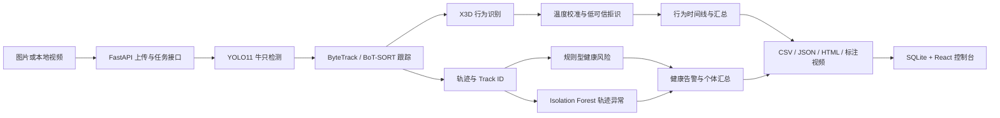

# `new大创` 项目完整评估报告

> 项目名称：星牧智控——牛只视觉识别、行为分析与健康风险辅助筛查系统  
> 项目目录：`F:\new大创`  
> 评估日期：2026-08-24  
> 评估范围：项目主线、独立 CBVD4 实验工作树、模型与数据资产、前后端实现、自动化测试、已有实验结果和后续研究计划  
> 报告性质：基于当前代码、文档、模型、实验产物和本次验证结果形成的阶段性技术评估

---

## 一、执行摘要

`new大创` 已经不是单纯展示界面或调用现成模型的玩具 Demo，而是一个具备完整输入、推理、分析、存储、展示和报告链路的科研原型。

当前项目已经实现：

- 牛只图像检测；
- 本地视频异步处理；
- ByteTrack 和 BoT-SORT 多目标跟踪；
- Track ID、轨迹 CSV 和带标注视频输出；
- 静止、疑似长时间卧倒、离群、活动下降和区域停留等规则型风险提示；
- 基于 Isolation Forest 的群体内轨迹异常检测；
- X3D 牛只行为识别、时序平滑、置信度校准和低可信拒识；
- SQLite 任务与告警记录；
- FastAPI 后端；
- React 浏览器控制台；
- 模型哈希校验、运行预检、降级运行和结构化实验报告；
- 真实 CBVD-5 外部视频上的跨域鲁棒性实验；
- 正在推进的 CBVD4 四分类迁移学习实验框架。

但是，项目的核心科学事实也必须明确：

1. 当前 CVB 行为模型在原始不均衡验证集上 Accuracy 较高，但 Macro-F1 只有 `0.2189`，类别能力不均衡；
2. 在 CBVD-5 strict 四分类外部测试上，零样本 Macro-F1 只有 `0.0048`，证明当前行为模型不能直接跨域部署；
3. 规则健康风险与无监督轨迹异常尚未获得兽医标注或真实疾病结局验证；
4. 当前只有网上公开牛只视频，没有真实牧场长期数据、热成像、核心体温或疾病标签；
5. CBVD4 适配训练与最终三臂测试仍未完成，当前只有一个中断训练的 epoch 结果；
6. 尚未实现跨视频永久身份、实时摄像头流、边缘部署和生产级运维。

因此，当前最准确的项目定位是：

> **具有完整工程闭环和可审计研究流程的牛只视觉健康辅助筛查科研原型，适合比赛答辩、大学生创新项目结题和论文实验继续深化，但尚不属于可直接无人值守部署的牧场产品。**

---

## 二、评估范围与证据来源

本报告评估了以下内容：

### 2.1 项目主线

- Git 分支：`integration`
- 主要运行说明：`README.md`
- Python 后端与算法：`cattle_health_app/`
- 规则健康监测：`health_monitor.py`
- React 前端：`web/`
- 自动化测试：`tests/`、`delivery_tests/`、`web/src/*.test.tsx`
- 模型：`models/detection/`、`models/behavior/`
- 实验记录：`docs/experiments/`
- 外部数据记录：`docs/data/`

### 2.2 独立实验工作树

- 目录：`.worktrees/cross-domain-behavior/`
- Git 分支：`codex/cross-domain-behavior`
- 内容：CBVD4 数据冻结、训练、动态标签空间、评估缓存、模型晋级协议与产品披露
- 当前状态：代码尚未合并到 `integration` 主线，正式训练与最终测试尚未完成

### 2.3 本次实际验证

本次评估实际执行了：

- 项目启动预检；
- 模型 SHA256 核对；
- 主线 Python 全量测试；
- React 测试；
- React 生产构建；
- CBVD4 相关针对性测试；
- CBVD4 数据清单、阶段性训练产物和进程状态核对。

没有在本次评估中重新运行耗时的视频验收或完整模型训练，因此相应内容会明确标注为“已有历史验收”或“尚未完成”。

---

## 三、项目目标与问题定义

项目试图解决的不是单一的“识别牛”问题，而是将公开视频中的视觉信息转化为可供牧场人员复核的结构化证据：

```text
牛只视频或图片
    ↓
牛只检测
    ↓
多目标跟踪与个体轨迹
    ↓
规则型健康风险 + 轨迹异常 + 行为识别
    ↓
置信度、不确定性与拒识
    ↓
结构化报告、告警记录和可视化界面
    ↓
人工巡检与后续处置参考
```

系统当前应输出“风险提示”和“人工复核建议”，不能输出确定性疾病诊断。

---

## 四、系统总体架构



### 4.1 技术栈

| 层级 | 技术 |
| --- | --- |
| 检测 | Ultralytics YOLO11 |
| 跟踪 | ByteTrack、BoT-SORT |
| 行为识别 | PyTorch、PyTorchVideo、X3D-XS |
| 异常检测 | scikit-learn Isolation Forest |
| 视频与图像 | OpenCV、Pillow |
| 后端 | FastAPI、Uvicorn、Pydantic |
| 数据存储 | SQLite、CSV、JSON、HTML、本地媒体文件 |
| 前端 | React 18、TypeScript、Vite、Vitest |
| 实验分析 | NumPy、Pandas、SciPy、Matplotlib |

### 4.2 项目规模

本次统计得到：

| 项目 | 数量 |
| --- | ---: |
| Python 文件 | 118 |
| Python 代码行 | 约 18,101 |
| Web TypeScript/TSX 文件 | 11 |
| Web TypeScript/TSX 代码行 | 约 1,431 |
| Python 测试文件 | 63 |
| Markdown 项目文档 | 19 |

该规模已经明显超过临时演示脚本，具备模块化科研软件的基本形态。

---

## 五、已经完成的功能与模块

### 5.1 牛只目标检测

状态：**已完成，可运行**。

已实现：

- JPG、JPEG、PNG、BMP 图片上传；
- MP4、AVI、MOV、MKV 视频上传；
- 检测置信度、IoU 和类别过滤参数；
- 检测框、类别和置信度输出；
- 带框结果图片；
- 检测模型路径、状态和 SHA256 披露；
- 模型缺失时启动预检失败，避免系统假装可用。

当前模型：

- 文件：`models/detection/yolo11s-waid.pt`
- 来源说明：WAID4500 YOLO11s，960 输入、120 轮训练
- SHA256：`46d734cba7553f31e89e739156f50e9a675b176f798c70159838497531771a64`

评估：检测链路工程上完整，但项目中缺少当前模型在独立检测测试集上的 mAP、Precision、Recall 和跨场景误检率报告。因此可以宣称“检测功能可运行”，不宜仅根据演示视频宣称“检测精度达到生产水平”。

### 5.2 视频异步任务

状态：**已完成，可运行**。

已实现：

- 视频上传后返回异步任务；
- 任务状态和进度查询；
- 按已处理帧数更新真实进度；
- 失败状态与错误信息持久化；
- 单文件默认上限 512 MB；
- 旧视频识别接口保留为弃用兼容接口；
- 本地结果文件按任务目录隔离。

当前局限：任务系统适用于单机演示与研究，不是分布式持久任务队列；程序异常退出后的任务恢复、并发配额和多用户隔离仍需加强。

### 5.3 多目标跟踪

状态：**已完成，可运行**。

已实现：

- ByteTrack；
- BoT-SORT；
- 连续 Track ID；
- 带 Track ID 的结果视频；
- 逐帧轨迹 CSV；
- 后续行为、健康规则和异常检测共享同一轨迹信息。

当前局限：Track ID 只在单个视频任务中有效，没有实现跨视频永久身份、耳标识别或长期 Re-ID。

### 5.4 规则型健康风险分析

状态：**已完成工程实现，尚未完成医学有效性验证**。

支持的风险规则：

| 规则 | 当前依据 | 输出性质 |
| --- | --- | --- |
| 静止 | 像素速度持续低于阈值 | 巡检提示 |
| 疑似长时间卧倒 | 检测框宽高比持续达到阈值 | 高风险复核提示 |
| 离群 | 与最近牛只的像素距离持续过大 | 巡检提示 |
| 活动量下降 | 近期平均速度相对基线下降 | 巡检提示 |
| 区域停留异常 | 在配置区域内停留时间过长 | 巡检提示 |

产物包括：

- 健康告警 CSV；
- 个体健康汇总 CSV；
- HTML 健康报告；
- SQLite 告警记录；
- 前端告警列表与风险分布。

关键问题：规则使用 `px/s`、像素距离和检测框比例，受相机角度、安装高度、分辨率和透视影响。没有完成相机标定前，这些阈值不能跨场景直接复用。

### 5.5 轨迹异常检测

状态：**已完成研究性实现**。

已实现：

- 以同一视频中的牛群为参照；
- 每条轨迹提取约 15 维运动和空间特征；
- 使用 Isolation Forest 判断群体内异常个体；
- 输出 0–1 异常得分；
- 输出异常的主要贡献特征；
- 轨迹少于 5 条时明确跳过；
- 异常结果写入 CSV、SQLite 和前端；
- 异常检测失败不影响检测、跟踪和规则报告。

评估：该模块的创新价值在于“群体相对异常”，但目前没有异常行为真值标签，不能用识别出的离群点数量证明疾病识别准确。透视造成的框面积差异也可能成为异常来源。

### 5.6 X3D 牛只行为识别

状态：**已完成研究原型接入，模型效果仍需提升**。

主线行为模型：

- 文件：`models/behavior/cvb_x3d_v2_best.pt`
- 架构：X3D
- 输入：16 帧、224×224
- 标签空间：CVB12
- SHA256：`731c6ed39dcf002915e888c829e1f86727f815331a2b3c21d06a17d40d62a08e`

已实现：

- 按 Track ID 生成行为输入；
- 行为分类与中文显示；
- 时间平滑；
- 置信度和归一化熵；
- 行为时间线 CSV；
- 逐轨迹行为汇总 CSV；
- 结构化 JSON 研究报告；
- 行为模型缺失或失败时的降级运行；
- 校准文件与模型哈希绑定；
- 校准文件不匹配时拒绝加载策略。

主线模型当前验证指标：

- Accuracy：`0.8342201645`
- Macro-F1：`0.2188597786`

高 Accuracy 主要由类别不均衡和“无法确定”等大类推动，Macro-F1 更能反映各类能力。该模型不能被描述为十二类均可靠。

### 5.7 可信度校准与选择性预测

状态：**已完成真实实验并接入运行时**。

实验遵循：

- 验证集只用于拟合温度和选择阈值；
- 测试集只用于最终评估；
- 校准产物与模型 SHA256 绑定；
- 低置信度或数据集不安全类别可以拒绝输出；
- 运行时记录拒识原因。

独立测试子集结果：

| 方案 | ECE↓ | 产品有效覆盖率 | 可用行为覆盖率 | 接受样本 Macro-F1↑ | 选择性风险↓ |
| --- | ---: | ---: | ---: | ---: | ---: |
| 未校准 + 固定 0.45 | 0.2857 | 0.00% | 0.00% | — | — |
| 温度校准 + 固定 0.45 | 0.0753 | 55.43% | 62.89% | 0.5589 | 0.4192 |
| 温度校准 + 置信度/熵联合拒识 | 0.0753 | 55.43% | 62.89% | 0.5589 | 0.4192 |

结论：温度校准显著改善了域内置信度质量；本轮熵阈值没有提供超过固定置信度阈值的额外收益。该结果应表述为“校准型选择性行为识别”，不能表述为完整开放集识别。

### 5.8 数据准备与可复现性

状态：**已完成较完整的科研数据治理框架**。

已实现：

- 数据集注册表；
- 数据许可和来源记录；
- 下载预算与文件哈希；
- 安全解压与路径边界；
- 标签映射；
- 虚拟片段解码；
- 质量测量；
- 按源视频或个体组划分数据；
- 防止同源片段泄漏；
- 训练、验证、测试清单哈希；
- 实验协议指纹；
- 大体积原始数据不提交 Git；
- 逐操作数据台账。

这部分是项目当前最有价值的研究工程成果之一。

### 5.9 后端 API

状态：**已完成本地原型接口**。

当前主要接口：

| 方法 | 接口 | 功能 |
| --- | --- | --- |
| GET | `/api/health` | 服务健康状态 |
| GET | `/api/dashboard` | 仪表盘汇总 |
| GET | `/api/models` | 检测与行为模型状态、路径和元数据 |
| GET | `/api/experiments/cross-domain-behavior` | 跨域实验摘要 |
| GET | `/api/experiments/cross-domain-behavior/figures/{filename}` | 读取受控实验图表 |
| GET | `/api/alerts` | 告警列表 |
| POST | `/api/alerts/{alert_id}/resolve` | 处理告警 |
| POST | `/api/recognition/image` | 图片检测 |
| POST | `/api/jobs/video` | 创建视频任务 |
| GET | `/api/jobs/{job_id}` | 查询视频任务 |

已具备上传类型限制、大小限制、错误状态和图表白名单。当前系统以本地单用户使用为目标，没有登录、角色权限、审计账户和公网安全设计。

### 5.10 React 前端

状态：**已完成答辩演示级界面**。

已实现：

- 项目介绍页；
- 健康概览；
- 告警列表与处理；
- 个体记录；
- 图片识别；
- 视频任务创建与进度轮询；
- 结果视频展示；
- 轨迹、告警、汇总和报告下载；
- 轨迹异常展示；
- 行为识别状态和行为汇总；
- 行为模型失败或未加载提示；
- 跨域鲁棒性结果展示；
- 明确显示研究边界和非诊断声明。

评估：界面已经适合比赛现场展示，但仍缺少实时摄像头页面、多模型实验对比页面、样本证据回放和人工标注纠错闭环。

### 5.11 启动、停止与运行预检

状态：**已完成 Windows 本地交付流程**。

已提供：

- `启动项目.bat`；
- `停止项目.bat`；
- `start_delivery.ps1`；
- `stop_delivery.ps1`；
- Python、依赖、模型、API、Node、npm 和 Web 清单预检；
- API 与 Web 日志；
- 服务未就绪时日志尾部输出；
- 检测模型必需、行为模型可降级的启动策略。

本次运行 `start_delivery.ps1 -CheckOnly` 的结果为：**Delivery preflight passed**。

---

## 六、已有实验和证据评估

### 6.1 历史端到端交付验收

项目 `README.md` 记录的 2026-08-23 验收包括：

- 固定 WAID 图片检测到 26 头牛；
- 固定视频输入输出均为 210 帧；
- 视频跟踪得到 26 个 Track ID；
- 生成 5,460 行轨迹；
- 生成 26 条静止风险记录；
- Isolation Forest 标记 3 个轨迹异常个体；
- CSV、HTML、SQLite、API 仪表盘和模型哈希一致。

这些结果证明端到端链路可以运行，但本次报告没有重新执行该耗时验收，因此应视为已有项目验收记录，而不是本次重新测得的结果。

### 6.2 CVB 域内行为校准实验

状态：**完成**。

主要贡献：

- 验证集拟合温度；
- 冻结阈值后在测试集评估；
- 将低可信输出转化为可拒绝结果；
- 产物哈希与检查点绑定；
- 将策略真实接入视频运行时。

限制：测试采用确定性类别分层子集，分布不同于原始不均衡数据；验证集没有覆盖全部测试类别，因此不能宣称全部十二类均充分验证。

### 6.3 CVB → CBVD-5 零样本跨域实验

状态：**完成，结果为明确失败边界**。

数据：

- CBVD-5 Kaggle version 11；
- CC0 1.0；
- 本地 687 个 MP4，约 3.48 GB；
- strict：400 个样本、4 类、211 个源视频；
- extended：600 个样本、6 类、298 个源视频。

Strict 四类主要结果：

| 协议 | 覆盖率 | Accuracy | Macro-F1 | 选择性风险 |
| --- | ---: | ---: | ---: | ---: |
| 未校准 | 100.00% | 0.0025 | 0.0048 | 0.9975 |
| 已校准 | 100.00% | 0.0025 | 0.0048 | 0.9975 |
| 已校准 + 固定拒识 | 60.25% | 0.0000 | 0.0000 | 1.0000 |
| 已校准 + 质量拒识 | 94.50% | 0.0026 | 0.0048 | 0.9974 |

结论：

- 当前 CVB 模型不能直接迁移到 CBVD-5；
- 域内温度校准不能自动解决跨域问题；
- 固定拒识和启发式质量门没有产生有意义改善；
- 结果触发了预先规定的独立少样本适配计划；
- 不允许在已经查看的外测结果上重新调阈值包装性能。

这不是“实验失败导致项目失败”，而是形成了可信的负结果和下一阶段依据。对比赛答辩来说，必须把它讲成“发现跨域安全边界并触发适配”，不能隐藏数值或宣称已有高准确率。

### 6.4 六类视频退化压力实验

状态：**完成**。

已覆盖：

- 模糊；
- 低照度；
- 遮挡；
- 降采样；
- 丢帧；
- 视频压缩。

由于干净基线已经接近失效，曲线出现非单调变化不能解释为某种退化改善了模型。该实验的价值是证明评估框架完整，而不是用于比较哪类退化影响最大。

### 6.5 CBVD4 四分类迁移适配实验

状态：**框架完成，正式实验未完成**。

该实验位于 `.worktrees/cross-domain-behavior/`，尚未合并到主线。

冻结数据规模：

| 划分 | 样本数 | 源视频数 | 采食 | 饮水 | 站立反刍 | 卧姿反刍 |
| --- | ---: | ---: | ---: | ---: | ---: | ---: |
| Train | 4,399 | 278 | 2,024 | 286 | 449 | 1,640 |
| Validation | 984 | 60 | 446 | 62 | 93 | 383 |
| Test | 1,032 | 59 | 480 | 58 | 96 | 398 |

总计 6,415 个有效样本、397 个源视频，按源视频分组划分，当前记录中没有跨集合源视频泄漏。

已完成：

- CBVD4 标签空间；
- 三锚点动态裁剪与 2 秒视频片段协议；
- Kinetics 初始化；
- CVB 牛行为模型迁移初始化；
- 训练 checkpoint 与数据哈希绑定；
- 恢复训练检查；
- AMP 更新审计；
- 动态标签空间运行时；
- 模型标签覆盖披露；
- 四分类评估核心；
- 预测缓存、风险—覆盖率导出与预检；
- 测试集只读一次的保护机制。

已有阶段性结果：

- Kinetics 初始化、`workers=4` 的旧训练在 epoch 0 得到验证 Accuracy `0.7622`、Macro-F1 `0.6630`；
- 随后 Windows DataLoader worker 重新创建触发 `nvfuser_codegen.dll / WinError 1114`，该训练中断；
- `workers=0` 恢复 smoke test 成功，loss 为 `1.3780`，发生 2 次真实 optimizer 更新，checkpoint 能重新加载为 `[1,4]` 输出；
- 当前 `full_w0` 只有训练协议文件，没有 `history.csv`；
- 本次检查没有发现真实的 CBVD4 训练进程。

因此，不能将 `0.6630` 写为最终结果，也不能宣称 CBVD4 模型已经完成训练或通过晋级门槛。

计划中的最终三臂对照是：

1. 原 CVB12 模型在 CBVD4 上零样本评估；
2. Kinetics 初始化后进行 CBVD4 微调；
3. CVB 牛行为模型迁移后进行 CBVD4 微调。

模型晋级门槛为：

- Macro-F1 不低于 `0.70`；
- 每一类 F1 不低于 `0.60`。

只有验证集选择出的候选模型在冻结测试集达到门槛后，才应安装为应用默认 CBVD4 模型。

---

## 七、本次工程验证结果

### 7.1 启动预检

结果：**通过**。

检测模型与行为模型均为 ready，模型哈希与项目记录一致。

### 7.2 前端测试与构建

结果：**通过**。

- Test Files：3 passed；
- Tests：16 passed；
- TypeScript 构建：通过；
- Vite 生产构建：通过。

### 7.3 CBVD4 针对性测试

结果：**通过**。

- 108 passed；
- 覆盖 CBVD4、行为运行时和行为 API 动态状态等相关测试。

### 7.4 主线 Python 全量测试

结果：**未完全通过**。

- 543 passed；
- 4 skipped；
- 2 failed；
- 33 warnings。

两个失败均位于 `delivery_tests/test_external_behavior_cli.py`。新加入的安全策略要求实验输出必须位于 `project_root` 内，但测试使用了 C 盘系统临时目录作为输出，同时默认 `project_root` 为 F 盘项目目录，于是触发预期的 `ProtocolViolation`。

判断：

- 这不是检测、跟踪或推理主链路失败；
- 它反映了“路径安全强化后，旧测试夹具未同步声明临时 project_root”的测试兼容问题；
- 当前仍不能写“Python 全量测试全部通过”；
- 应修正测试夹具或明确测试临时根目录后，重新运行全量测试。

警告中还包括 PyTorch 学习率调度器在部分训练单元测试中报告 `lr_scheduler.step()` 早于 `optimizer.step()`。独立 CBVD4 实现已经增加真实 AMP 更新计数，但主线旧训练测试仍应继续审计。

### 7.5 环境一致性

项目要求文件固定 `opencv-python==4.9.0.80`，本次预检实际检测到 OpenCV `4.13.0`，说明当前环境与锁定依赖存在漂移。

前端 `package.json` 中 Vite、Vitest、React 插件、图标和动画等若干依赖使用 `latest`。虽然存在 `package-lock.json`，重新生成锁文件时仍可能引入不兼容升级。正式交付前建议固定直接依赖版本。

---

## 八、创新点评估

### 8.1 已经成立的创新点

#### 创新点一：面向域移风险的可审计牛只行为识别评估链

项目不是只给出一个 Accuracy，而是绑定：

- 数据来源与许可；
- 源视频分组；
- 标签映射边界；
- 数据清单 SHA256；
- 模型 SHA256；
- 验证集选择与测试集隔离；
- 预测缓存；
- 退化压力实验；
- 失败门控与独立适配计划。

这是当前最适合作为论文核心贡献的方向。

#### 创新点二：带校准和拒识机制的选择性行为识别

系统允许模型在不确定时拒绝输出，并用覆盖率、选择性风险和接受样本 Macro-F1 衡量“少做但更可信”的效果。相比单纯追求总体 Accuracy，这更符合真实牧场辅助筛查需求。

#### 创新点三：规则风险、群体轨迹异常和时序行为证据的多层融合

当前系统同时提供：

- 可解释规则；
- 无监督群体异常；
- 学习型行为识别；
- 置信度和拒识证据。

虽然还没有完成统一学习型融合，但多层证据已经形成产品和研究基础。

#### 创新点四：失败可见和能力降级

模型缺失、校准不匹配、行为推理失败、轨迹数量不足或实验产物无效时，系统会显示不可用、失败或跳过原因，而不是伪造完整结果。对农业 AI 的可信部署，这是有现实意义的工程创新。

### 8.2 正在形成、尚不能宣称完成的创新点

- CBVD4 中 Kinetics 迁移与牛行为域迁移的公平对照；
- 按源视频 bootstrap 的统计置信区间；
- 四分类模型按固定门槛自动晋级；
- 多标签空间模型在同一产品中的安全切换；
- 跨域适配后的风险—覆盖率改善。

这些必须等正式训练和冻结测试完成后再写成结果性创新。

### 8.3 不建议作为主要创新点的内容

- “使用了 YOLO”；
- “使用了 ByteTrack”；
- “使用了 Isolation Forest”；
- “做了一个 React 页面”；
- “调用大模型生成建议”。

这些单独看属于已有技术组合，只有与牛只场景、可信评估、失败门控和证据链结合后才具有项目价值。

---

## 九、成熟度评估

以下分数是阶段成熟度判断，不是算法精度分数。

| 维度 | 评分 | 评价 |
| --- | ---: | --- |
| 功能完整度 | 8.0/10 | 检测、跟踪、分析、存储、接口、前端和报告链路完整 |
| 工程可运行性 | 7.5/10 | 预检和前端构建通过，具备 Windows 启停脚本与降级机制 |
| 测试与可靠性 | 7.0/10 | 测试覆盖较广，但本次全量 Python 仍有 2 个失败 |
| 数据治理与可复现性 | 8.5/10 | 清单、哈希、协议、许可和测试隔离较完善 |
| 科研严谨性 | 8.0/10 | 能诚实报告负结果，并限制测试集使用与结论边界 |
| 行为模型当前有效性 | 4.0/10 | 域内类别不均衡，外部 strict Macro-F1 仅 0.0048 |
| 健康风险医学有效性 | 3.0/10 | 尚无兽医标签、体温真值和临床结局验证 |
| 跨场景泛化 | 2.5/10 | 单一外域测试显示严重失效，适配实验尚未完成 |
| 答辩演示成熟度 | 8.0/10 | 有完整界面、真实产物和可解释失败证据 |
| 真实牧场部署成熟度 | 3.5/10 | 缺真实牧场长期数据、标定、Re-ID、实时流和运维 |
| 论文潜力 | 7.5/10 | 可信评估与跨域适配方向清晰，仍需完成核心正向实验 |

综合判断：约为 **6.5/10 的科研原型成熟度**。

按技术成熟度等级理解，当前更接近 **TRL 4：实验室或公开数据环境中的系统验证**。完成真实牧场视频验证后，才有条件接近 TRL 5。

---

## 十、当前主要问题与风险

### 10.1 P0：直接影响实验可信度和交付

1. CBVD4 两组正式训练没有完成；
2. `full_w0` 没有训练历史，当前也没有训练进程；
3. 冻结测试集尚未执行；
4. 三臂统一评估和模型晋级尚未完成；
5. CBVD4 工作树尚未合并到主线；
6. 主线全量 Python 测试仍有 2 个失败；
7. 旧的 epoch 0 指标不能作为最终实验结果。

### 10.2 P1：影响论文质量

1. 检测模型缺少独立 mAP、Precision 和 Recall 报告；
2. 行为模型缺少完整逐类混淆原因分析；
3. 没有多个随机种子的方差或置信区间对照；
4. 没有迁移初始化、冻结策略、增强和拒识的完整消融；
5. 跨域压力实验因基线过低，不能支持退化敏感性排序；
6. 真实落地价值仍主要通过逻辑推断，缺牧场运营指标。

### 10.3 P1：影响真实部署

1. 只有公开视频，没有真实牧场长期视频；
2. 没有真实牛只永久身份；
3. 像素速度和像素距离无法跨摄像机直接比较；
4. 没有 RTSP 或实时摄像头输入；
5. 没有边缘设备性能与功耗测试；
6. 没有模型漂移监测与自动回滚；
7. 没有用户认证和细粒度权限；
8. 没有兽医标注、疾病结局或核心体温真值；
9. 没有 RGB 与热成像的时间同步和空间配准数据。

### 10.4 依赖与维护风险

1. 当前 OpenCV 实际版本与 requirements 固定版本不一致；
2. 前端若干直接依赖使用 `latest`；
3. Windows 中文路径、DLL 加载和目录替换曾多次暴露平台兼容问题；
4. 大模型权重和公开视频数据位于 Git 外，需要单独备份和完整性检查；
5. 实验工作树与主线并存，需要明确合并和版本发布流程。

---

## 十一、后续优化与实验计划

### 11.1 P0：先完成当前 CBVD4 证据链

- [ ] 修复或更新两个路径安全相关测试夹具。
- [ ] 重新运行主线 Python 全量测试并达到全绿。
- [ ] 启动 Kinetics 初始化的 `workers=0` 正式训练。
- [ ] 完成 CVB 牛行为迁移初始化的同预算训练。
- [ ] 两组训练严格使用相同的数据、epoch、有效 batch size、增强和调度器。
- [ ] 只使用验证集选择候选模型。
- [ ] 固化候选模型、配置和全部哈希。
- [ ] 一次性执行冻结测试集。
- [ ] 输出三臂 Accuracy、Balanced Accuracy、Macro-F1、逐类 F1、NLL、ECE 和 Brier。
- [ ] 按源视频进行 bootstrap，并给出 95% 置信区间。
- [ ] 输出混淆矩阵、校准曲线和风险—覆盖率曲线。
- [ ] 达到晋级门槛后再安装 CBVD4 模型。
- [ ] 将通过验证的 CBVD4 代码合并到 `integration` 主线。
- [ ] 用公开视频完成一次新的端到端视频演示。

### 11.2 P1：完成论文必要消融

- [ ] Kinetics 初始化与牛行为域迁移初始化对比。
- [ ] 冻结主干与不冻结主干对比。
- [ ] 不同 clip 长度或采样帧数对比。
- [ ] 有无时序平滑对比。
- [ ] 有无温度校准对比。
- [ ] 有无置信度拒识对比。
- [ ] 有无归一化熵拒识对比。
- [ ] 不同覆盖率下的选择性风险对比。
- [ ] 按类别和场景进行错误归因。

### 11.3 P1：补充工程指标

- [ ] CPU 和 GPU 单片段推理延迟。
- [ ] 整段视频端到端 FPS。
- [ ] 模型首次加载时间和稳定运行时间。
- [ ] GPU 显存、CPU 内存和磁盘占用。
- [ ] 不同视频分辨率下的吞吐量。
- [ ] ONNX 导出与数值一致性。
- [ ] 低功耗边缘设备部署可行性。
- [ ] 多任务并发和失败恢复测试。

### 11.4 P2：真实牧场验证

- [ ] 采集固定机位真实牧场视频。
- [ ] 记录摄像机高度、角度、分辨率和拍摄距离。
- [ ] 使用地面单应性或标尺将像素位移转换为物理距离。
- [ ] 建立耳标、外观 Re-ID 或其他永久身份关联。
- [ ] 收集人工行为观察记录。
- [ ] 收集兽医检查、体温和真实健康结局。
- [ ] 验证跨牧场、跨品种、跨季节和昼夜泛化。
- [ ] 将风险阈值改为经真实数据验证的场景化参数。

---

## 十二、1—3 个月建议执行路线

### 第 1—2 周：完成实验基础

- 修复全量测试；
- 固化环境依赖；
- 完成 Kinetics 和 CVB 迁移两组正式训练；
- 每个训练产物自动记录哈希、配置和训练历史。

### 第 3—4 周：完成冻结评估

- 验证集选择候选；
- 一次性测试；
- bootstrap 置信区间；
- 混淆矩阵；
- 校准与风险—覆盖率分析；
- 晋级或明确 No-Go。

### 第 5—6 周：完成系统集成与答辩 Demo

- 合并 CBVD4 功能；
- 安装通过门槛的模型；
- 完成模型标签范围披露；
- 使用公开视频完成端到端演示；
- 增加关键证据片段与错误样本展示。

### 第 7—8 周：完成论文实验章节

- 运行必要消融；
- 完成统计表和结果图；
- 编写方法、实验、结果、讨论和局限性；
- 整理数据许可、模型哈希和复现命令。

### 第 9—12 周：可选增强

- 工程性能测试；
- ONNX 或边缘部署预研；
- RGB 与热成像接口原型；
- VLM 解释接口原型；
- 真实牧场采集方案设计。

如果时间不足，应优先完成正式训练、冻结测试和答辩证据，不应在核心实验未完成前投入大量时间做 VLM 界面。

---

## 十三、比赛答辩建议

### 13.1 推荐项目主线

建议用以下叙事：

> 现有牛只行为模型在单一数据域内可能表现良好，但换到另一个公开连续视频域时会发生严重失效。本项目不仅实现检测、跟踪和行为识别，还构建了数据防泄漏、可信度校准、低可信拒识、跨域压力测试和失败门控机制，并进一步开展源视频隔离的四分类迁移适配，使系统知道“何时可以预测、何时必须交给人工”。

### 13.2 答辩中建议展示的内容

1. 系统整体架构；
2. 图片和视频真实运行；
3. Track ID、轨迹和健康报告；
4. 行为时间线和低可信拒识；
5. CVB 域内校准结果；
6. CBVD-5 跨域失效结果；
7. 为什么失败以及如何触发独立适配；
8. CBVD4 三臂正式实验结果；
9. 项目边界和后续真实牧场计划。

### 13.3 不应使用的表述

- “系统已经可以诊断牛只疾病”；
- “模型在各种牧场都能准确识别”；
- “Accuracy 83.4%，所以十二类行为都很准确”；
- “热成像已经能检测发热”；
- “VLM 已经实现自主巡检”；
- “跨域实验效果很好”。

### 13.4 推荐创新点标题

1. **面向域移风险的可审计牛只行为识别与失败门控方法**；
2. **基于温度校准和风险—覆盖率约束的选择性牛只行为识别**；
3. **融合规则风险、群体轨迹异常和时序行为证据的牛只健康辅助筛查原型**。

---

## 十四、论文方向评估

### 14.1 最适合的论文主题

推荐主题：

> **面向公开牧场视频域移的可信牛只行为识别：校准、拒识、跨域评估与源视频隔离适配**

该主题比“基于 YOLO 的牛只检测系统”更有研究价值，因为 YOLO 和 ByteTrack 本身不是新方法，而项目在可信评估和域移治理上已经具备真实证据。

### 14.2 可形成的论文贡献

1. 构建源视频隔离、标签映射透明、哈希绑定的公开牛只视频评估协议；
2. 研究域内温度校准和选择性拒识在牛只行为识别中的风险—覆盖率特性；
3. 用真实外部数据证明域内校准不能自动解决域移，并形成可审计失败门控；
4. 比较通用视频预训练与牛行为域预训练对 CBVD4 迁移适配的影响；
5. 将可信行为识别接入可运行的检测、跟踪和健康辅助筛查系统。

### 14.3 论文尚缺内容

- 两组完整适配训练；
- 冻结测试集结果；
- 三臂统一对照；
- bootstrap 置信区间；
- 初始化与拒识消融；
- 错误案例可视化；
- 推理性能；
- 更明确的数据集和现实场景局限讨论。

在这些内容完成前，项目适合形成论文初稿和实验设计，不适合提交以“提出有效适配方法”为主要结论的论文。

---

## 十五、多模态、VLM 与具身智能后续方向

该方向应放在当前 CBVD4 实验之后。

### 15.1 RGB + 红外/热成像

建议首先完成接口原型：

- RGB 和热成像双流输入；
- 时间戳同步；
- 空间配准；
- 环境温度、湿度和拍摄距离元数据；
- 缺失模态降级；
- 体表热点区域可视化；
- 温度异常风险提示。

真实发热筛查至少需要：

- 可追溯的热像仪型号和标定；
- 发射率设置；
- 环境温湿度；
- 拍摄距离与角度；
- 同步核心体温或兽医测温；
- 足够数量的正常与发热个体；
- 个体级而非帧级数据划分。

在这些数据缺失时，只能展示热成像接口与风险原型，不能宣称体温或发热诊断有效。

### 15.2 VLM

VLM 最适合用于解释和检索，不应替代当前视觉模型的量化评估：

- 对异常视频片段生成自然语言描述；
- 汇总检测、轨迹、行为和不确定性证据；
- 回答“为什么这头牛被标记为异常”；
- 返回对应时间段、Track ID 和视频证据；
- 生成需要人工确认的巡检建议；
- 对低置信度片段进行辅助审核。

VLM 输出必须引用结构化证据，不能无依据生成疾病诊断。

### 15.3 与具身智能的结合

长期可以形成：

```text
RGB/热成像/环境传感器
    ↓
检测、跟踪、身份和行为感知
    ↓
可信度与风险分析
    ↓
VLM 解释、检索和任务规划
    ↓
人工审批
    ↓
PTZ 摄像头、巡检机器人或牧场设备执行
    ↓
反馈结果进入后续复核
```

当前项目已经具备其中的“感知与结构化风险证据”基础，但不具备机器人执行、安全控制和闭环反馈验证。

---

## 十六、最终结论

### 16.1 是否是玩具 Demo

不是。

理由：

- 具备完整前后端；
- 具备真实模型和本地推理；
- 具备异步视频任务；
- 具备结构化数据、SQLite 和多种报告；
- 具备较多自动化测试；
- 具备模型哈希、数据清单和实验协议；
- 运行了真实公开外部视频实验；
- 能诚实显示模型失效与降级状态。

### 16.2 是否已经真实落地

还没有。

原因：

- 行为模型跨域性能严重不足；
- CBVD4 适配实验未完成；
- 没有真实牧场长期数据；
- 健康风险没有医学真值；
- 没有相机标定、永久身份、实时流和边缘部署验证；
- 当前仍是本地单机原型。

### 16.3 当前最准确的阶段判断

> 项目已经达到“可用于比赛答辩、科研实验和后续牧场试点设计”的程度；下一步必须把主要资源集中到 CBVD4 正式训练、冻结测试、统计分析和模型晋级上。只有形成可信的正向跨域适配结果，并在真实牧场数据上继续验证后，项目才能从科研原型走向可落地系统。

---

## 十七、关键文件索引

| 内容 | 路径 |
| --- | --- |
| 项目运行说明 | `README.md` |
| 后端 API | `cattle_health_app/api.py` |
| 本地媒体处理 | `cattle_health_app/media_processor.py` |
| 视频跟踪管线 | `cattle_health_app/tracking_pipeline.py` |
| 视频任务服务 | `cattle_health_app/jobs.py` |
| SQLite 仓库 | `cattle_health_app/repository.py` |
| 规则健康监测 | `health_monitor.py` |
| 轨迹异常检测 | `cattle_health_app/anomaly/detector.py` |
| 行为运行时 | `cattle_health_app/behavior/runtime.py` |
| 行为校准 | `cattle_health_app/behavior/calibration.py` |
| 选择性预测指标 | `cattle_health_app/behavior/uncertainty.py` |
| 跨域实验 | `cattle_health_app/behavior/cross_domain_experiment.py` |
| React 主界面 | `web/src/App.tsx` |
| 识别工作台 | `web/src/RecognitionStudio.tsx` |
| 跨域结果界面 | `web/src/CrossDomainResults.tsx` |
| 可信行为实验报告 | `docs/experiments/2026-08-23-trustworthy-behavior-results.md` |
| 跨域实验报告 | `docs/experiments/2026-08-23-cross-domain-behavior-results.md` |
| 公开数据操作记录 | `docs/data/2026-08-23-public-cattle-video-data-record.md` |
| CBVD4 实验工作树 | `.worktrees/cross-domain-behavior/` |

---

## 十八、报告更新规则

后续发生以下变化时，应更新本报告：

- CBVD4 正式训练完成；
- 候选模型冻结；
- 测试集首次读取；
- 三臂指标或置信区间生成；
- 模型达到或未达到晋级门槛；
- CBVD4 分支合并到主线；
- 全量测试恢复为通过；
- 新增真实牧场数据；
- 新增热成像、VLM 或具身设备实验。

更新时必须保留旧结果和失败原因，不应覆盖或删除对项目结论不利但真实存在的实验记录。
