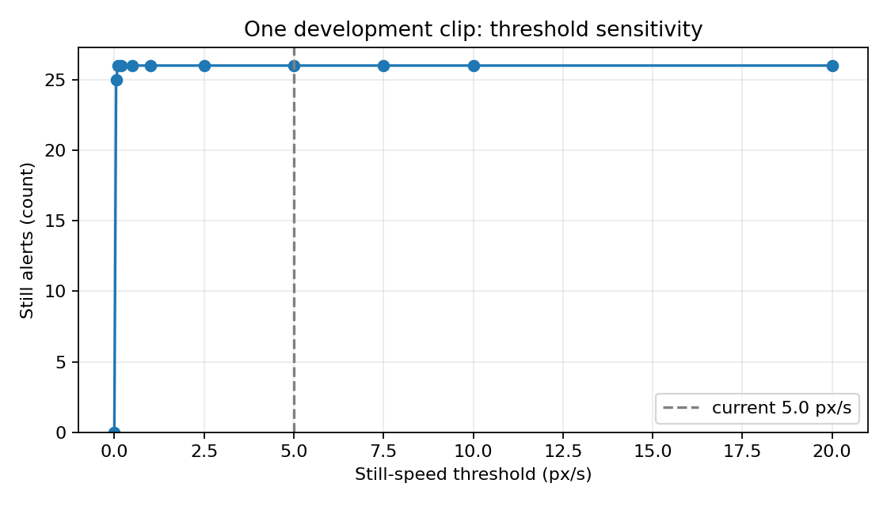

# 静止速度阈值灵敏度分析（开发素材，非精度评估）

## 问题与数据边界

当前规则以连续 **20 秒**速度不超过 **5.0 px/s** 触发一次 `still` 提示。本分析只问“改变这个速度阈值，告警数量怎样变”；没有人工健康真值，因此不计算准确率、召回率或误报率，也不改交付阈值。

本机 `data/media/results/` 中有五份牛视频结果，但对应上传源文件 SHA-256 全为 `8A7C40A3CF8C2996BB1B4085EF222B3D39695A1D7D56B05D773861A55BFBA68C`，五份轨迹 CSV SHA-256 全为 `A60DF7AEF8F4C1A9488EF37F0F458716792AFA158C37C2F94237628AE5F7E05C`。它们是**同一段开发素材的重复处理**，不能报告成“五段独立视频”。另有一份 5 帧 WebM 处理结果，也来自同一画面；时长不足 20 秒，不纳入本次曲线。公开羊视频不适用牛静止规则。

使用任务 `202d89f9aaad433480d8570bd90c3d41` 的轨迹 CSV：210 帧、10 fps、20.9 秒、26 个视频内 ID。沿用 `CattleHealthMonitor` 的其余默认配置和已保存检测框，不重新跑检测/追踪，不读取 CBVD4 冻结 test 集。只替换 `still_speed_px_s`，逐帧回放含空帧的轨迹，统计 `still` 提示和触发的不同 Track ID。当前 5.0 px/s 回放得到 26 条，与保存的原始告警 CSV 的 26 条一致。

## 结果

| 速度阈值（px/s） | `still` 提示数 | 触发的不同视频内 ID |
| ---: | ---: | ---: |
| 0 | 0 | 0 |
| 0.05 | 25 | 25 |
| 0.1 | 26 | 26 |
| 0.2 | 26 | 26 |
| 0.5 | 26 | 26 |
| 1.0 | 26 | 26 |
| 2.5 | 26 | 26 |
| **5.0（当前）** | **26** | **26** |
| 7.5 | 26 | 26 |
| 10.0 | 26 | 26 |
| 20.0 | 26 | 26 |



**解释**：这段固定画面非常静止。阈值达到 0.1 px/s 后，26 条轨迹全部触发；从 0.1 到 20 px/s 的曲线完全平坦。因此这段视频**不能解释为什么选 5.0 px/s**，也不能区分 5.0 与其他正阈值的业务效果。26 条是规则输出数量，不能解释为 26 头病牛或 26 次真实异常。

## 复现

在仓库根目录运行：

```powershell
& 'F:\deepl\anaconda1\envs\pytorch\python.exe' scripts/analyze_still_threshold.py `
  'data/media/results/202d89f9aaad433480d8570bd90c3d41/85d2f51a58a94e3299efb65681246295_tracks.csv' `
  --fps 10 --frame-count 210 `
  --thresholds 0 0.05 0.1 0.2 0.5 1 2.5 5 7.5 10 20 `
  --plot docs/analysis/still-threshold-sensitivity-2026-10-26.png
```

## 下一步

保持当前阈值不变。先取得不同机位、含真实运动的授权牛视频，逐段标记拍摄条件和人工可判读结论，再用同一脚本画各视频的阈值—告警数曲线；有人工真值后才能讨论误报、漏报和阈值取舍。不同分辨率/视角下的 px/s 不可直接比较。
